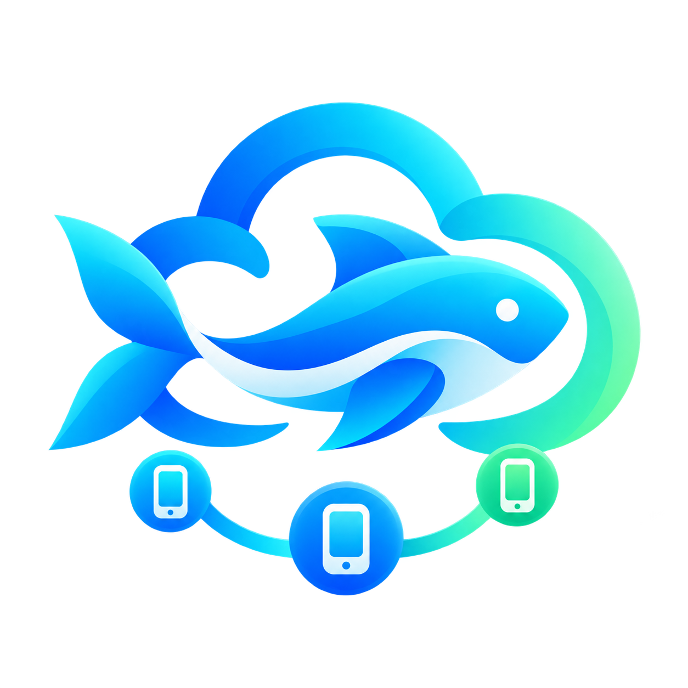
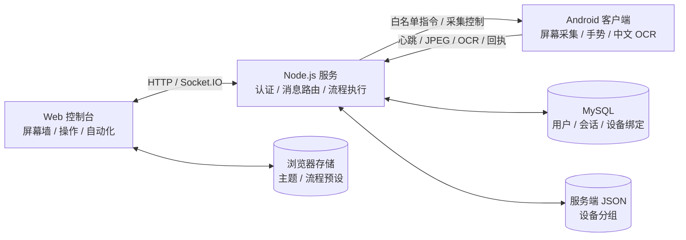

<p align="center">
  
</p>

<h1 align="center">cloudeQK · 小鱼云群控</h1>

<p align="center"><strong>在一个网页里查看多台 Android 设备，完成远程操作与自动化编排。</strong></p>

<p align="center">实时屏幕墙 · 单机与分组控制 · 可视化流程 · 中文 OCR · 用户与设备管理</p>

<p align="center">
  
  
  
</p>

cloudeQK 面向自有或已获授权的 Android 设备管理场景。浏览器提供设备列表、实时画面和操作工作台，Node.js 服务负责登录、设备绑定与消息路由，Android 客户端负责屏幕采集、中文文字识别和白名单动作执行。

**[下载与版本](#downloads)** · **[功能总览](#features)** · **[技术栈](#tech-stack)** · **[快速开始](#quick-start)** · **[版本更新](#version-history)** · **[常见问题](#faq)**

> 使用前需要设备用户手动开启无障碍服务，并确认系统录屏授权。当前为 MVP；设备兼容性、网络表现和自动化效果需要在实际设备上验证。

<a id="downloads"></a>

## 下载与版本

| 项目 | 当前标识 | 获取方式与说明 |
| --- | --- | --- |
| **Android APK** | **OCR v1.2-fix（文件名）** | [查看并下载 APK 文件](release/cloudeQK-OCR-v1.2-fix.apk) |
| Android 包内版本 | `versionName 1.0` · `versionCode 1` | 现存 APK 为可调试构建；文件名不等于 Android 安装版本 |
| Android 源码 | `versionName 1.0` · `versionCode 1` | [构建配置](android/app/build.gradle.kts)；当前源码另有后续修复，见下方记录 |
| 服务端 | `1.0.0` | [package.json](server/package.json)；Web 控制台随服务端一起部署 |
| 版本记录 | Git 提交历史 | 当前没有 Git Tag；下文按包标识和源码迭代分别记录 |

本地安装包位于 `release/`。通过 GitHub 查看文件或提交记录时，请使用具有仓库访问权限的账号。

**安装包与源码的对应关系：** 现有 `v1.2-fix.apk` 在 2026-08-29 由 `v1.1-debug.apk` 原样重命名，两者内容相同。相较该历史包，当前 Android 源码另有双击动作、相对坐标与屏幕尺寸修复，不能据此认为下载包已经包含这些修改。需要这些修复时，请按[源码构建](#development)生成并验证新的 APK。

<details>
<summary>查看现存 APK 校验信息</summary>

- 文件：`release/cloudeQK-OCR-v1.2-fix.apk`
- 大小：48,454,692 字节，约 46.21 MiB。
- 包名：`com.example.deviceclient`
- 最低 SDK：26；目标 SDK：35。
- SHA-256：

```text
F08438658A85D6765E3AAD92752745EA80BAE1C49832A54F144439C1D38D5E2F
```

</details>

<a id="features"></a>

## 功能总览

| 你要完成的事 | 当前提供的能力 |
| --- | --- |
| **集中查看设备** | 在线状态、设备搜索、实时 JPEG 屏幕墙；画面布局支持 2–8 列调整 |
| **远程操作一台手机** | 点击画面进入单机控制，支持点击、滑动、文本输入、打开应用、返回、主页与最近任务 |
| **同时操作多台设备** | 选择全部在线、已选设备或设备分组；按屏幕相对坐标分发动作 |
| **管理设备接入** | 网页生成设备专属 Token，Android 保存连接配置；管理绑定关系与设备归属 |
| **编排重复操作** | 可视化流程模块、受限文本 DSL、浏览器本地预设、执行进度与取消 |
| **使用屏幕文字** | Android 端 ML Kit 中文 OCR；关键词策略可依据画面识别结果执行预设动作 |
| **管理协作账号** | 管理员创建与批量创建账号、设置设备额度、封禁用户、调整设备归属 |
| **调整工作台外观** | 浅色 / 深色切换并记住选择；集中显示连接状态、操作日志与错误反馈 |

普通账号的设备列表与控制请求按设备归属过滤；管理员拥有跨用户管理入口。设备分组由服务端文件保存，流程预设保存在当前浏览器的 `localStorage` 中。

### 自动化的使用范围

工作台既支持手工编排，也包含抖音 / 小红书相关测试预设和 OCR 关键词策略。这些预设依赖目标应用界面、坐标和设备状态；仓库中的实现与测试不代表已完成真实平台效果验收。

DSL 的“执行完成”表示服务端流程已结束，**不等于每台手机的每一步都已成功**。实际操作仍需结合设备回执与屏幕画面检查。

<a id="tech-stack"></a>

## 技术栈

<p align="center">
  
  
  
  
  
</p>
<p align="center">
  
  
  
  
  
</p>

| 层次 | 技术与版本依据 | 用途 |
| --- | --- | --- |
| Web 控制台 | Vue **3.5.13**、原生 JavaScript / CSS | 本地加载 Vue，无独立前端打包步骤 |
| 服务端 | Docker 基础镜像 Node.js **22 Alpine**；Express **5**、Socket.IO **4**、mysql2 **3** | HTTP 接口、会话、指令路由与数据库访问 |
| 数据存储 | Compose 镜像 MySQL **8.4**；服务端 JSON；浏览器 localStorage | 用户 / 会话 / 绑定、设备分组、本地流程预设 |
| Android 客户端 | Kotlin **2.1.0**、Java **17**、minSdk **26**、compileSdk / targetSdk **35** | 原生设备连接与操作界面 |
| 投屏与操作 | MediaProjection、AccessibilityService、Socket.IO Android Client **2.1.2** | JPEG 画面采集与白名单动作 |
| 中文 OCR | ML Kit `text-recognition-chinese:16.0.1` | 在设备端识别屏幕文字并回传结果 |
| 构建与部署 | Gradle **8.9**、Android Gradle Plugin **8.7.3**、Docker Compose | APK 构建与服务部署 |
| 测试 | Node.js 内置 `node:test`、`node:assert` | 协议边界、Cookie、DSL 与预设校验 |

版本来自当前仓库配置；服务端的精确依赖以 [package-lock.json](server/package-lock.json) 为准。技术图标通过 Shields.io 加载，离线阅读时可直接参考上表。

## 系统如何协作



- **按需编码与发送：** 在设备已批准录屏的前提下，有画面订阅或 OCR 任务时启用编码、发送与对应识别；无需求时暂停处理，系统录屏授权和前台服务仍保留。
- **画面参数：** 当前源码将画面宽度限制在 720 像素以内，JPEG 质量为 60，发送间隔至少 200 毫秒。这些是实现参数，不是性能保证。
- **动作坐标：** 点击与滑动使用 `0–1` 的相对坐标，Android 根据屏幕尺寸换算。
- **身份与消息：** 网页使用登录会话 Cookie；设备使用绑定 Token。会话令牌与设备 Token 在数据库中以哈希保存。

<a id="quick-start"></a>

## 快速开始

### 1. 使用 Docker Compose 部署

准备好 Docker 与 Compose，在项目根目录复制配置：

```powershell
Copy-Item .env.example .env
```

Linux / macOS 对应命令：

```bash
cp .env.example .env
```

编辑 `.env`，设置以下变量后再启动：

| 变量 | 填写内容 |
| --- | --- |
| `MYSQL_ROOT_PASSWORD` | 自行设置的 MySQL root 密码 |
| `DB_USER` / `DB_PASSWORD` | 应用数据库账号与密码；账号默认 `cloudeqk` |
| `DB_NAME` | 数据库名，默认 `cloudeqk` |
| `ADMIN_USERNAME` / `ADMIN_PASSWORD` | 首次初始化的管理员账号与密码；账号默认 `admin` |
| `APP_PORT` | 网页对外端口，默认 `6001` |

三个密码分别设置，不要直接使用模板占位内容。服务端数据库用户使用应用账号即可。

```bash
docker compose config --quiet
docker compose up -d --build
docker compose ps
```

打开 [本机控制台](http://localhost:6001/)，使用自己在 `.env` 中设置的管理员账号登录。若修改了 `APP_PORT`，请使用对应端口。部署文件见 [docker-compose.yml](docker-compose.yml) 与 [Dockerfile](Dockerfile)。

**检查服务状态：**

```powershell
Invoke-RestMethod http://localhost:6001/health
```

Linux / macOS：

```bash
curl -fsS http://localhost:6001/health
```

健康接口应返回 `{"ok":true}`。登录、绑定设备和真实操作还需要继续验证。

### 2. 绑定 Android 设备

1. 登录网页，进入 **绑定设备**，创建绑定记录并复制设备 Token。
2. 安装上方 APK，或自行构建当前 Android 源码；打开 **小鱼 云群控**。
3. 填写服务器地址和 Token，保存后检查连接状态。真机使用服务器域名或电脑的局域网 IP；Android 模拟器连接宿主机时通常使用 `http://10.0.2.2:6001`。
4. 点击 **开启无障碍服务**，在系统设置中启用本应用服务。
5. 点击屏幕共享按钮，确认系统录屏授权；回到网页检查画面和设备状态。

手机里的 `localhost` 指向手机自身，不能用它访问电脑上的服务。客户端会保存连接配置，并在之后打开时尝试重新连接。

### 3. 选择范围并执行操作

- **单机控制：** 点击屏幕墙中的设备进入控制画面，检查当前目标。
- **批量控制：** 在顶部选择全部在线、已选设备或设备分组，再发送动作。
- **分组管理：** 创建分组、勾选设备并保存，后续可按组操作。
- **自动化：** 先用少量步骤验证坐标和回执，再保存为本地预设；运行中可取消。

### 数据保存与升级

| 数据 | 当前保存位置 |
| --- | --- |
| 用户、会话、设备绑定 | Compose 命名卷 `mysql_data_v3` |
| 设备分组 | 命名卷 `server_data_v2`，挂载到 `/app/server/data` |
| 页面主题、用户保存的流程预设 | 当前浏览器 localStorage |
| Android 服务器地址与 Token | Android 应用本地配置 |

Docker 通常会为卷名加上 Compose 项目前缀。更换浏览器不会自动同步本地流程预设。

已有 MySQL 数据卷保留初始化时的账号密码，**修改 `.env` 不会自动重置数据库密码**；管理员初始化变量也只在对应账号不存在时用于创建账号。升级前备份数据库与分组文件，保留旧数据卷以便恢复，不要把 `docker compose down -v` 作为常规更新命令。

公网部署应配置 HTTPS / WSS，并在反向代理中支持 Socket.IO 的 WebSocket 连接，设置合适的访问控制与请求限制。

<a id="development"></a>

## 从源码运行与构建

### 服务端与 Web

准备 Node.js 22 和可访问的 MySQL 数据库。下面是 PowerShell 示例，先把占位密码替换为自己已配置的值：

```powershell
cd server
npm ci

$env:DB_HOST='127.0.0.1'
$env:DB_PORT='3306'
$env:DB_USER='cloudeqk'
$env:DB_PASSWORD='<应用数据库密码>'
$env:DB_NAME='cloudeqk'
$env:ADMIN_USERNAME='admin'
$env:ADMIN_PASSWORD='<首次管理员密码>'
$env:PORT='6001'

npm start
```

启动时服务端会尝试创建数据库和表；本地 MySQL 账号需已存在，并具备目标数据库的相应权限。Web 由服务端直接提供，打开 [本机控制台](http://localhost:6001/) 即可。

项目根目录的 `.env` 供 Docker Compose 使用；直接 `npm start` 不会自动读取它，需像上面一样提供环境变量。

### Android APK

使用 Android Studio 打开 `android/`，准备 JDK 17 与 Android SDK 35，也可在配置好 SDK 路径后执行：

```powershell
cd android
.\gradlew.bat --no-daemon assembleDebug
```

输出：`android/app/build/outputs/apk/debug/app-debug.apk`。重新构建前请核对 [Android 版本配置](android/app/build.gradle.kts)；当前 `versionName` / `versionCode` 尚未随文件名变化。

### 运行现有测试

在项目根目录执行：

```powershell
npm --prefix server test
node --check web/app.js
git diff --check
```

现有测试覆盖指令参数边界、Cookie 的 HTTPS 标记、DSL 解析、设备 Token 格式、服务端预设、无限循环取消与 OCR 关键词参数。真实数据库登录、手机授权、投屏和远程动作需另行联调。

## 自动化 DSL

脚本由服务端逐行解析，不使用 `eval`，不提供 Shell、文件或任意网络访问。文本 DSL 最多 **100 步**、总长度不超过 **20,000 字符**；单次 `WAIT` 为 **0–60,000 毫秒**。服务端预设有独立的参数校验，不能用 DSL 的步数限制推断所有预设的运行时长。

```text
# 打开系统设置，点击、滑动，然后回到桌面
OPEN com.android.settings
WAIT 1000
TAP 0.5 0.5
SWIPE 0.5 0.8 0.5 0.2 350
BACK
HOME
```

| 指令 | 作用 |
| --- | --- |
| `OPEN <packageName>` | 打开指定包名的应用 |
| `WAIT <ms>` | 等待指定毫秒数 |
| `TAP <x> <y>` | 点击相对位置 |
| `SWIPE <x1> <y1> <x2> <y2> [ms]` | 相对坐标滑动；默认 300 毫秒，有效时长 100–5,000 毫秒 |
| `TEXT <text>` | 向当前可编辑控件输入文本，最多 2,000 字符 |
| `BACK` / `HOME` / `RECENTS` / `NOTIFICATIONS` | 返回、主页、最近任务、通知栏 |

<details>
<summary>开发者参考：主要 Socket.IO 事件</summary>

设备连接携带 `auth: { role: "device", token, deviceId }`；网页使用已登录的 HttpOnly 会话 Cookie。

| 方向 | 事件 | 用途 |
| --- | --- | --- |
| App → Server | `device:register` / `device:heartbeat` | 注册资料 / 每 10 秒上报心跳 |
| Server → Web | `devices:snapshot` / `device:status` | 初始设备列表 / 状态变化 |
| Web → Server | `command:send` | 提交 `requestId`、`deviceIds` 与白名单 `command` |
| Server → App | `command:execute` | 执行动作 |
| App → Server → Web | `command:result` | 回传 `requestId`、`deviceId`、`ok`、`message` |
| Web → Server | `screen:subscribe` / `screen:unsubscribe` | 订阅 / 取消订阅画面 |
| Server → App | `screen:control` | 控制画面采集与 OCR 开关 |
| App → Server → Web | `screen:frame` | Base64 JPEG 帧与尺寸信息 |
| App → Server | `screen:ocr` | 屏幕文字识别结果 |
| Web → Server | `automation:run` / `automation:cancel` | 运行脚本或预设 / 取消本网页发起的运行 |
| Server → Web | `automation:progress` / `automation:done` | 进度 / 流程结束 |

当前协议接受 `openApp`、`tapRelative`、`doubleTapRelative`、`swipeRelative`、`inputText`、`globalAction`。其中双击已在源码中实现，现存历史 APK 的支持情况见[下载与版本](#downloads)。

完整参数与校验见 [protocol.js](server/src/protocol.js)、[automation.js](server/src/automation.js) 和 [服务端入口](server/src/index.js)。

</details>

## 仓库目录

```text
cloudeQK/
├─ README.md                         # 项目说明、部署与版本记录
├─ .env.example                      # Compose 环境变量模板
├─ docker-compose.yml                # Node.js + MySQL 服务与持久卷
├─ Dockerfile                        # Node.js 22 Alpine 镜像
├─ web/
│  ├─ brand-icon.png                 # 项目 Logo
│  ├─ index.html / login.html        # 工作台与登录页
│  ├─ app.js                        # Vue 状态、操作与流程编排
│  ├─ vue.global.prod.js            # 仓库内置 Vue
│  └─ *.css                         # 主题与功能页面样式
├─ server/
│  ├─ package.json / package-lock.json
│  ├─ src/
│  │  ├─ index.js                   # HTTP、Socket.IO、设备与分组
│  │  ├─ auth.js / db.js            # 会话、用户、数据库与设备绑定
│  │  ├─ protocol.js               # 白名单指令校验
│  │  └─ automation.js             # DSL、预设与关键词策略
│  └─ test/                        # Node.js 测试
├─ android/
│  ├─ app/build.gradle.kts          # Android SDK、版本与依赖
│  └─ app/src/main/
│     ├─ AndroidManifest.xml
│     └─ java/com/example/deviceclient/
│        ├─ MainActivity.kt         # 连接设置与系统授权入口
│        ├─ SocketManager.kt        # 连接、心跳与指令回执
│        ├─ ScreenCaptureService.kt # 投屏与中文 OCR
│        └─ RemoteAccessibilityService.kt
└─ release/
   └─ cloudeQK-OCR-v1.2-fix.apk      # 当前保留的历史 OCR 构建
```

`node_modules/`、Android 构建缓存、本地工具和 `server/data/` 属于运行或生成内容，已由 [.gitignore](.gitignore) 排除；`release/*.apk` 为显式保留的交付文件。

<a id="version-history"></a>

## 版本更新

以下日期按 **Git 入库或变更日期** 记录。项目尚未统一源码版本号与 APK 文件命名，因此无独立版本号的迭代按日期列出；重命名、源码修复与实际构建分别说明。

### APK 版本记录

| 版本标识 | 日期 | 更新内容 | 状态与依据 |
| --- | --- | --- | --- |
| **v1.2-fix** | 2026-08-29 | 将 OCR `v1.1-debug` 安装包重命名，二进制内容未变化；包内版本仍为 `1.0 (1)`。 | **当前保留的历史 Debug 包**；[重命名记录](https://github.com/zhongchuangEDU-AI/cloudeQK/commit/f86704a) |
| **v1.1-debug** | 2026-08-28 | 引入 ML Kit 中文 OCR、按需识别与结果回传、关键词匹配自动化和 OCR 超时提示；补充 Gradle / Maven 国内镜像配置。 | OCR 源码与安装包入库，随后改名；[提交记录](https://github.com/zhongchuangEDU-AI/cloudeQK/commit/5c04027) |
| **v1.0** | 2026-08-24 | 建立 Node.js / Vue / Android 三端结构，提供登录与用户管理、设备状态与分组、屏幕墙、远程操作和受限自动化 DSL。 | [初始提交](https://github.com/zhongchuangEDU-AI/cloudeQK/commit/2176cc6)；旧包于 2026-08-29 [移除](https://github.com/zhongchuangEDU-AI/cloudeQK/commit/74ff862) |

### 源码迭代记录

下列迭代没有单独提升应用版本号。表内同时涉及 Web、服务端与 Android，不能仅凭 APK 文件名判断是否包含某次源码更新。

| 日期 | 更新主题 | 具体变化 | 提交依据 |
| --- | --- | --- | --- |
| **2026-08-29** | Docker 持久化与启动配置 | 调整 MySQL 启动等待与部署配置；当前数据库使用 `mysql_data_v3`，分组数据使用 `server_data_v2`。 | [66f27a0](https://github.com/zhongchuangEDU-AI/cloudeQK/commit/66f27a0) · [0e4933c](https://github.com/zhongchuangEDU-AI/cloudeQK/commit/0e4933c) |
| **2026-08-29** | 统一相对坐标协议 | 点击与滑动统一为 `0–1` 屏幕比例；同步调整网页表单、流程模块、DSL、服务端校验与 Android 分发，移除旧绝对像素指令。 | [e1648af](https://github.com/zhongchuangEDU-AI/cloudeQK/commit/e1648af) |
| **2026-08-29** | 双击与关键词策略 | 增加 `doubleTapRelative`，调整 Android 屏幕尺寸获取；预设使用画面中心双击，改进关键词匹配与滑动参数校验。 | [a2af4b7](https://github.com/zhongchuangEDU-AI/cloudeQK/commit/a2af4b7) |
| **2026-08-28** | HTTP 登录与本地前端依赖 | Cookie 按 HTTPS 状态设置 `Secure`；Vue 改为仓库本地资源；为 `crypto.randomUUID()` 增加兼容回退，修复 HTTP 环境的初始化问题。 | [d8d40ee](https://github.com/zhongchuangEDU-AI/cloudeQK/commit/d8d40ee) · [2090e4b](https://github.com/zhongchuangEDU-AI/cloudeQK/commit/2090e4b) · [b056532](https://github.com/zhongchuangEDU-AI/cloudeQK/commit/b056532) |
| **2026-08-28** | Docker 数据库配置 | 补充环境变量模板，分离数据库管理员与应用账号配置，调整健康检查与持久化卷。 | [5c04027](https://github.com/zhongchuangEDU-AI/cloudeQK/commit/5c04027) · [2f3edcb](https://github.com/zhongchuangEDU-AI/cloudeQK/commit/2f3edcb) · [db55409](https://github.com/zhongchuangEDU-AI/cloudeQK/commit/db55409) |
| **2026-08-27** | 控制台交互与持续运行 | 增加屏幕墙列数调整、单机拖动滑动、快捷文本输入、回执超时提示与错误浮层；预设支持 `-1` 持续运行及主动取消。 | [aee3a99](https://github.com/zhongchuangEDU-AI/cloudeQK/commit/aee3a99) |
| **2026-08-27** | 服务端自动化预设 | 增加抖音 / 小红书测试预设与参数界面，支持停留、滑动、互动频率与上限设置，并扩展参数测试。 | [13a67b7](https://github.com/zhongchuangEDU-AI/cloudeQK/commit/13a67b7) |
| **2026-08-25** | Docker 部署与应用选择 | 增加 Node.js 22 Alpine + MySQL Compose 部署、健康检查与默认 `6001` 端口；优化设备应用搜索、启动与状态合并。 | [e2236ba](https://github.com/zhongchuangEDU-AI/cloudeQK/commit/e2236ba) · [5ce5363](https://github.com/zhongchuangEDU-AI/cloudeQK/commit/5ce5363) |
| **2026-08-24** | 设备绑定与昼夜主题 | 增加设备专属 Token、单设备绑定和设备名额管理；重绘登录页与控制台，增加并保存浅色 / 深色选择。 | [f512745](https://github.com/zhongchuangEDU-AI/cloudeQK/commit/f512745) · [242be75](https://github.com/zhongchuangEDU-AI/cloudeQK/commit/242be75) |

<a id="faq"></a>

## 常见问题

| 现象 | 检查方法 |
| --- | --- |
| 登录后页面空白 | 当前源码已加入 HTTP 环境下的 `newId()` 兼容处理；确认部署了最新 `web/app.js` 与 `web/index.html`，并刷新页面 |
| MySQL 提示 `Access denied` | 核对实际数据卷、数据库账号与密码；已有卷不会因修改 `.env` 而重置账号 |
| Docker 服务无法正常启动 | 查看 `docker compose ps -a`，再运行 `docker compose logs --since=5m --tail=100 mysql server` |
| 设备在线但没有画面 | 确认设备端已批准录屏，网页正在订阅画面；检查手机后台限制与网络连接 |
| 能看画面但无法操作 | 检查无障碍服务是否已开启、当前操作范围与目标设备；同时核对 APK 是否包含所需动作实现 |
| 出现“设备未返回执行结果” | 当前网页在约 1.5 秒未收到设备结果时提示；“已投递”只表示服务端已发送，仍需检查客户端状态与回执 |
| 切换浏览器后找不到流程 | 自定义预设保存在原浏览器 localStorage；数据库不会自动恢复这些本地预设 |

---

更多实现细节可从 [服务端](server/src/index.js)、[Web 控制台](web/app.js) 与 [Android 客户端](android/app/src/main/java/com/example/deviceclient/) 查看；变更依据见 [Git 提交历史](https://github.com/zhongchuangEDU-AI/cloudeQK/commits/main/)。
